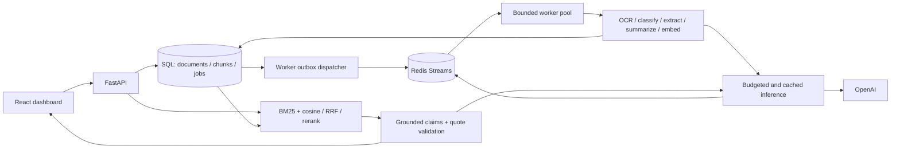

# Architecture and operations

## Application map

The backend is a synchronous SQLAlchemy/FastAPI application with SQL-persisted
Document and Chunk rows. The React/MUI frontend provides uploads, document lists,
details, analytics, and a search/answer interface. OCR dispatches by MIME/extension
to pypdf, python-docx, Tesseract, or UTF-8 decoding. A six-category classifier
(Invoice, Contract, Resume, Financial Report, Insurance Claim, Other) chooses the
field-extraction schema and summary prompt. The original accuracy datasets and
Prometheus/Grafana instrumentation are retained and extended.

## Retrieval and grounding

`services/embeddings.py` produces exact source substrings bounded by tokens,
with configurable overlap and paragraph/sentence boundaries. Encoding is cl100k_base
for the existing models; if the vocabulary cannot load, UTF-8 byte counts provide
a conservative budget. Embedding requests respect both input count and cumulative
token limits and preserve order using response indices.

`services/retrieval.py` snapshots chunks joined to completed documents. It computes
BM25 with k1=1.5, b=.75 and exact normalized cosine similarity. Each candidate is a
**chunk**, so several useful sections of a single document can survive retrieval.
Reciprocal rank fusion adds 1/(60+rank) from each candidate list. Hybrid reranking
uses one strict JSON Schema LLM scoring request over a bounded candidate set; lexical reranking
is an explicitly selectable low-cost baseline. Hybrid is the default based on the synthetic latency/quality baseline; reranking remains selectable. Reranker responses must account for
the candidate IDs; invalid scores fail the request rather than silently corrupting
ranking. Hybrid/vector searches require compatible embedding dimensions. When you
change embedding models, reprocess the corpus; equal dimensions alone do not prove
semantic compatibility.

`services/rag.py` packs passages within the configured context budget and requests
atomic claims with quotes. The server checks every source ID and exact quote
against the text actually sent to the model, builds numbered citations, and drops
claims with invalid sources. An empty evidence/claim set abstains. This establishes
source integrity; it does **not** prove entailment or eliminate model mistakes.
Citation links include a source-text digest so an old answer cannot silently point
to changed content after reprocessing. Quotes remain in the answer even if the
source document is later deleted. PDF extraction flattens page text, so citations
reference chunk positions rather than page numbers.

The exact SQL backend avoids cross-process staleness and needs no vector service,
but loads and scores the corpus for each query. Use an ANN/indexed search backend
for large collections. The retained legacy `VectorIndex` is not on the active path.

## Queue consistency and recovery

`processing_jobs` is an additive table created by `init_db`; existing document and
chunk tables are unchanged. One job row per document stores attempts, stage,
status, timestamps, trace context, publication time, and lease ownership. Replays
reuse that job row and reset attempts. It is a current-state ledger, not a full
historical audit log. Existing documents can be adopted using Reprocess.

1. Upload writes a UUID-named file and commits the Document and Job in the same
   SQL transaction. No Redis or model call runs in the upload request. A supplied
   idempotency key is unique in SQL; a SHA-256 of file bytes + filename detects
   conflicting reuse, including concurrent requests. Keep the key through retries.
2. Each worker's dispatcher publishes eligible SQL rows to the Redis `idp:jobs`
   stream. Unclaimed rows are republished after 15 seconds. A crash between XADD
   and SQL commit can duplicate delivery; a broker outage cannot erase SQL intent.
3. A conditional SQL UPDATE claims runnable jobs, increments attempts, and grants
   a random lease token. Only queued/due-retry jobs or expired processing jobs
   are eligible. Concurrent claims cannot both succeed.
4. A heartbeat renews ownership every third of the lease duration. Stage updates
   require the same token and an unexpired lease. Computation happens outside long
   database transactions.
5. The final conditional job UPDATE fences the commit transaction. The worker
   replaces chunks and document outputs and marks the job succeeded atomically.
   Expired workers roll back rather than overwriting replacement work.
6. Temporary failures become retrying with exponential backoff (capped at 300s)
   and jitter. Missing files/empty extracted text are permanent failures. Exhausted
   attempts enter `dead`. The dispatcher detects workers killed on the last
   attempt and also dead-letters them. SQL dead rows are the authoritative ledger;
   the bounded Redis dead stream is a delivery/diagnostic view.
7. Stream messages are ACKed/deleted after durable worker outcomes. Idle pending
   messages are reclaimed with XAUTOCLAIM. Replayed or duplicate messages remain
   harmless because SQL decides whether work may start or commit.

The guarantee is at-least-once execution with fenced output publication. External
provider calls can repeat after a crash; response caching reduces repeat spend but
does not make provider execution exactly-once. Redis loss can discard delivery
hints, inference cache, and concurrency permits; SQL outbox recovery republishes
eligible work. Redis AOF + noeviction are configured for the local deployment.
Active documents reject deletion; retry/reprocess coalesces active requests.

API liveness does not depend on Redis availability: uploads remain accepted while
queued work waits. Operate at least one worker, monitor its scrape target and
queue states, and investigate/replay dead jobs through `/api/jobs/{id}/retry`.
On SIGTERM workers stop fetching and wait for running threads. A forced kill
recovers after the lease expires. Use distinct metrics ports per host process.

SQLite WAL and short write transactions serve a local worker pool. All processes
must share identical database and upload paths. For multi-host workers, use
PostgreSQL plus shared file/object storage; install the appropriate SQL driver.
There is no auth/tenant boundary yet. Do not expose this local stack as a public
multi-tenant service without adding those controls.

## Inference and cost accounting

`services/llm.py` centralizes model routing, budgets, provider timeouts, response
cache, embeddings batching, distributed inference permits, and usage measurement.
The OpenAI SDK's automatic retries are disabled: document retry policy belongs to
the job system. Interactive search receives a retryable 503 on inference failures
or permit exhaustion. Worker capacity backpressure reschedules work without exhausting the failure retry budget. Every provider request is bounded by a Redis lease lasting
longer than its configured SDK timeout; normal completion releases it, crashes
expire it. Redis server time avoids cross-host clock skew for inference permits. Limits apply across all API and worker processes sharing Redis.

Cache keys hash operation, model, prompts, and generation options. Redis stores
cached model outputs/embeddings with TTL; those outputs may contain document data.
Set CACHE_TTL_SECONDS=0 to disable the application cache. Static system instructions
precede variable document content for provider prefix reuse. Do not pad prompts
just to trigger caching. Actual `prompt_tokens_details.cached_tokens` is measured;
provider cache hits are separate from application response-cache hits.

Input, output, document, embedding-batch, and RAG context limits are configurable. MAX_DOCUMENT_TOKENS bounds total embedding work per uploaded document. Oversized
chat prompts fail explicitly; context is packed/truncated before calling the
provider. Classification/extraction/summarization still use their original head
snippets (4k/8k characters); long-document field extraction is not exhaustive.
The optional high-quality route uses COMPLEX_MODEL when supplied; otherwise it
uses the ordinary route. Routes expect Chat Completions JSON mode, strict JSON Schema, temperature,
and max_tokens support; reasoning-model parameter adaptation is not included.

Per-model MODEL_PRICES stores USD per million input/output/cached-input tokens.
Estimates use measured provider usage, including calls whose returned JSON cannot
be used. Missing prices produce null cost in API/evaluation responses. Prometheus
cost series count only configured models; they are not an invoice reconciliation.
Example rates in `.env.example` were checked against the official model pages on
2026-10-23 and must be reviewed when changing providers/models:

- [GPT-4o mini pricing](https://developers.openai.com/api/docs/models/gpt-4o-mini)
- [Embedding pricing](https://developers.openai.com/api/docs/models/text-embedding-3-small)
- [Provider prompt caching](https://developers.openai.com/api/docs/guides/prompt-caching)

## Evaluation interpretation

`backend/evals/rag_dataset.json` labels document relevance, expected fields,
reference answers, accepted fact aliases, and unanswerable questions. The runner
builds an isolated in-memory corpus from that file; it never uploads documents
or modifies the application database. The original accuracy evaluator still
supports its existing category/field datasets and thresholds.

Recall@K counts unique relevant document IDs among K **passages**. Duplicate chunks
cannot inflate recall. MRR is truncated at K. Unanswerable questions have undefined
retrieval recall/MRR and are excluded from those means; they are scored for answer
abstention. Answer correctness requires all alias-labeled facts, no abstention on
answerable questions, and citations only to labeled relevant documents. Token F1
is also reported. Alias matching and relevant-document citation precision cannot
catch every unsupported extra claim, semantic paraphrase, or swapped relationship;
human review and richer domain labels remain necessary.

Every strategy uses the same corpus and questions. Corpus embedding setup is
reported separately from per-query tokens, latency, and cost. Each generated answer
reuses its measured retrieved passages rather than retrieving twice. Reports keep
per-query outputs and errors, config, dataset hash, p50/p95 latency, and aggregate
quality. Failed queries score zero and fail CLI gates; unknown costs stay null.
Output reports are explicit artifacts rather than claims of production performance.

Offline mode uses bag-of-terms fixture vectors and lexical reranking to verify
ranking plumbing without network calls. It deliberately leaves answer/extraction
scores null. Live mode uses real configured embeddings and LLMs. Cold mode disables
only the application cache; provider prefix caching remains measurable. Warm repeated
trials help quantify caching. Compare separate reports with different context budgets
or balanced/high routes. At least several repeated trials and held-out, representative
labels are needed for useful latency and quality comparisons.

## Observability

API and worker processes each expose their own Prometheus registry. Histograms
support p50/p95 for requests, job attempts, retrieval/reranking, LLM requests, and
queue wait. Counters track errors/outcomes/tokens/cost/cache hits. Queue depth is a
SQL state count refreshed by worker dispatch; use `max by (state)`, not a sum across
worker replicas. Worker availability alerts catch stale/missing metrics. Queue wait
currently measures elapsed time from original creation on every attempt, including
retry delay.

OpenTelemetry carries W3C context from HTTP into the SQL job row and worker spans,
then nests pipeline/retrieval/provider spans. OTLP HTTP exports to Tempo when the
endpoint is configured. Traces contain IDs, models, stage names, counts and error
types; prompts, document text, and raw exception messages are omitted. The local
Tempo instance retains trace blocks for 24h but uses ephemeral storage. Grafana
provisions Prometheus and Tempo; alert rules are supplied without external
notification routing.

Relevant implementation references:
[Redis pending-message reclaim](https://redis.io/docs/latest/commands/xautoclaim/),
[OpenTelemetry Python instrumentation](https://opentelemetry.io/docs/languages/python/instrumentation/).
